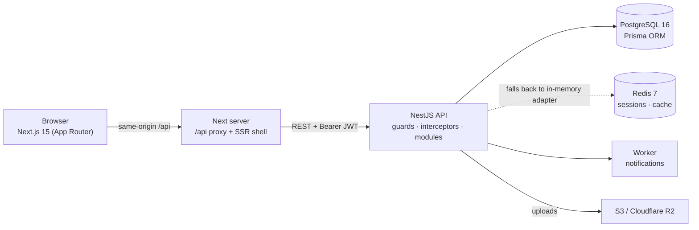
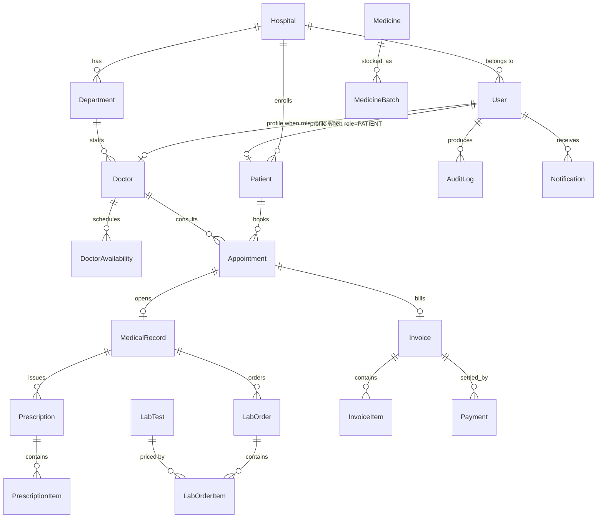

# MedCore HMS

Enterprise-grade, multi-tenant **Hospital Management System** — patient care, appointments, medical records, laboratory, pharmacy and billing behind one secure web platform.

<p align="center">
  <strong>NestJS · Prisma · PostgreSQL · Next.js 15 · Redis · Docker · GitHub Actions</strong>
</p>

---

## Table of contents

- [What it does](#what-it-does)
- [Architecture](#architecture)
- [Data model](#data-model)
- [Tech stack](#tech-stack)
- [Quick start](#quick-start)
- [Demo credentials](#demo-credentials)
- [API](#api)
- [Testing](#testing)
- [Security](#security)
- [Project structure](#project-structure)
- [Deployment](#deployment)

---

## What it does

| Module | Capability |
| --- | --- |
| **Auth** | Email/password sign-in, JWT access tokens (15 min), refresh-token **rotation with replay detection**, httpOnly refresh cookie, per-device sessions, throttled endpoints |
| **RBAC** | 9 roles — `SUPER_ADMIN`, `HOSPITAL_ADMIN`, `DOCTOR`, `NURSE`, `RECEPTIONIST`, `LAB_TECHNICIAN`, `PHARMACIST`, `ACCOUNTANT`, `PATIENT` — enforced by a NestJS guard on every route |
| **Multi-tenancy** | Every hospital is an isolated tenant; queries are scoped by `hospitalId`, platform operators can cross tenants, cross-tenant access raises `TENANT_MISMATCH` |
| **Appointments** | Weekly doctor availability → free-slot derivation, double-booking prevention (`409 SLOT_UNAVAILABLE` / `PATIENT_DOUBLE_BOOKED`), state machine `PENDING → CONFIRMED → IN_PROGRESS → COMPLETED` with cancellation/no-show |
| **EMR** | Encounter records per appointment: chief complaint, presenting symptoms, vitals, diagnosis + ICD-10, treatment plan, allergies; moving an appointment to `IN_PROGRESS` opens the record |
| **Prescriptions** | Itemised scripts (drug, dosage, frequency, duration) attached to an encounter, with dispensing status and PDF route |
| **Laboratory** | Test catalogue, orders with priority (`ROUTINE/URGENT/STAT`), sample → process → approve workflow, per-item result values with `NORMAL/LOW/HIGH/ABNORMAL` flags |
| **Pharmacy** | Formulary per tenant, batch stock with expiry, low-stock and ≤30-day expiry alerts, FIFO dispensing that refuses expired/quarantined batches |
| **Billing** | Invoices with line items, discount/tax, draft → issued → paid lifecycle, cash/card/UPI/insurance payments, webhook stubs for Stripe & Razorpay |
| **Analytics** | Dashboard KPIs, 30-day revenue series, 14-day appointment volume, department load |
| **Audit log** | Every state-changing action recorded with actor, entity and before/after snapshot |

Seed data ships **2 hospitals, 8 departments/doctor schedules, 30 patients, 50+ appointments, 27 invoices, 27 lab orders and 27 prescriptions** so every screen has content on first run.

---

## Architecture



**Request pipeline:** `Helmet → CORS allow-list → rate limiter → cookie parser → JWT guard (unless @Public) → Roles guard → controller → Prisma → TransformInterceptor ({ success, data, message, meta }) → AllExceptionsFilter ({ success:false, error:{ code, message } })`.

Every response follows the envelope from the PRD §08, so clients can unwrap payloads and surface error codes uniformly.

---

## Data model

22 Prisma models, 17 enums. The clinical core:



Remaining models: `Address`, `Vaccination`, `Notification`, `AuditLog`.

**Design notes**

- Soft deletes (`deletedAt`) everywhere — records are never hard-deleted.
- Money is `Decimal`, scaled before it reaches the JSON layer.
- Refresh tokens are stored server-side as `rt:{userId}:{deviceId}` with a TTL, so rotation and global revoke are single-key operations.

---

## Tech stack

| Layer | Choice |
| --- | --- |
| Frontend | Next.js 15 (App Router), React 19, TypeScript, Tailwind CSS, dependency-free SVG charts |
| Backend | NestJS 11, Passport JWT, class-validator DTOs, Swagger/OpenAPI, Socket.IO-ready |
| Data | PostgreSQL 16 + Prisma 6 (typed client, migrations, seed) |
| Cache | Redis 7 via ioredis — **automatic in-memory fallback** so the app runs without Redis in dev |
| Tooling | pnpm workspaces, ESLint 9 flat config, Jest, ts-jest |
| Infra | Docker Compose (postgres/redis/api/web/nginx), GitHub Actions CI, nginx reverse proxy |

---

## Quick start

Requirements: **Node ≥ 20**, **pnpm 9**, **PostgreSQL 16** (or Docker).

```bash
git clone <your-repo-url> medcore-hms && cd medcore-hms

# 1. Install the workspace (backend + frontend + shared types)
pnpm install

# 2. Configure
cp .env.example .env
cp backend/.env.example backend/.env      # then edit DATABASE_URL + JWT secrets

# 3. Database: create schema, apply migration, load demo data
createdb medcore                          # or use docker compose up postgres
pnpm db:generate
pnpm db:migrate
pnpm db:seed

# 4. Run both apps (API :3001, web :3000)
pnpm dev
```

Open **http://localhost:3000** and sign in with a demo account below. Swagger lives at **http://localhost:3001/api/docs**.

<details>
<summary>Docker path (full stack)</summary>

```bash
cp .env.example .env   # fill JWT secrets
docker compose up --build
# web → http://localhost:8080   api → http://localhost:3001/api
```
</details>

<details>
<summary>Ports were already taken on your machine</summary>

```bash
PORT=3101 pnpm --filter backend start            # API on 3101
cd frontend && API_PROXY_TARGET=http://localhost:3101 pnpm exec next dev -p 3200
```
The browser always calls the API through the same origin (`/api/...`); the Next
server proxies to `API_PROXY_TARGET`, so no CORS configuration is required.
</details>

---

## Demo credentials

Every seeded account uses the password **`Passw0rd!123`**.

| Account | Role | Sees |
| --- | --- | --- |
| `superadmin@medcore.demo` | Platform operator | Both hospitals, all modules, audit log |
| `admin.chennai@medcore.demo` | Hospital admin | Chennai hospital only |
| `reception.chennai@medcore.demo` | Reception | Booking, patients, invoices |
| `dr.<first>.<last>@medcore.demo` | Doctor | Own schedule, encounters, prescriptions |
| `lab.chennai@medcore.demo` | Lab technician | Orders, results, approvals |
| `pharmacy.chennai@medcore.demo` | Pharmacist | Formulary, stock, dispensing |
| `accounts.chennai@medcore.demo` | Accountant | Invoices, payments, revenue |
| `<first>.<last>.<n>@medcore.demo` | Patient | Own appointments, records, bills |

`pnpm db:seed` prints the exact list of generated addresses.

---

## API

Base path `​/api` — interactive docs at `/api/docs` (Swagger).

| Area | Endpoints |
| --- | --- |
| Auth | `POST /auth/login` `POST /auth/refresh` `POST /auth/logout` `POST /auth/logout-all` `GET /auth/me` `POST /auth/register` `POST /auth/forgot-password` `POST /auth/reset-password` `POST /auth/verify-email` `POST /auth/verify-phone` |
| Org | `GET/POST /hospitals` `GET/PATCH /hospitals/:id` `GET/POST /hospitals/:id/departments` `GET/POST /users` `GET/PATCH /users/:id` |
| Scheduling | `GET/POST /appointments` `GET /appointments/:id` `PATCH /appointments/:id/status` `DELETE /appointments/:id` `GET /doctors/:id/slots` `GET/PUT /doctors/:id/availability` |
| Clinical | `POST /medical-records` `GET /medical-records/:id` `GET /medical-records/patient/:patientId` `GET/POST /prescriptions` `GET /prescriptions/:id/pdf` |
| Lab | `GET/POST /lab-tests` `GET/POST /lab-orders` `PATCH /lab-orders/:id/result` `POST /lab-orders/:id/approve` |
| Pharmacy | `GET/POST /medicines` `POST /medicines/:id/batches` `GET /medicines/alerts` `POST /dispense` |
| Billing | `GET/POST /invoices` `POST /invoices/:id/issue` `POST /invoices/:id/pay` `POST /payments/webhook/stripe` |
| Ops | `GET /analytics/overview` `GET /analytics/revenue` `GET /analytics/appointments` `GET /analytics/departments` `GET /audit` `GET /notifications/me` |

Pagination (`page`, `limit`, `q`) returns `{ data, meta: { page, limit, total, totalPages } }`.

---

## Testing

```bash
pnpm --filter backend test          # Jest unit/integration suites
pnpm typecheck                      # types + backend + frontend
pnpm build                           # prisma/nest/next production builds
```

The suite covers the PRD's mandatory scenarios: slot derivation and conflict detection, appointment state-machine transitions, invoice totals and payment application, lab result flagging, tenancy isolation, and the security rules (password policy, RBAC matrix).

An end-to-end smoke script exercises the **running** API — login, token rotation + replay rejection, every module endpoint, RBAC 401/403s, patient data isolation, free-slot lookup, double-booking `409`, and cancellation:

```bash
API=http://localhost:3001/api bash backend/smoke.sh $API
# PASSED=43  FAILED=0
```

---

## Security

- **Passwords** — bcrypt (cost 12) with a timing-safe decoy hash so unknown emails take the same time as wrong passwords.
- **Tokens** — 15-minute JWT access tokens; refresh tokens rotate on every use and presenting a consumed token revokes the whole device session (`REFRESH_TOKEN_REUSED`).
- **Refresh cookie** — `httpOnly`, `SameSite=Strict`, `Path=/api/auth`, `Secure` in production; never readable from JS.
- **RBAC + tenancy** — `@Roles(...)` on every route, plus service-level `hospitalId` scoping; platform admins are the only cross-tenant role.
- **Transport** — Helmet defaults (CSP, HSTS, frame-ancestors, no sniffing).
- **Rate limiting** — throttler on auth routes (30 requests/min per IP).
- **Auditability** — `AuditLog` rows for create/update/delete/login with before/after snapshots.
- **Validation** — class-validator DTOs; malformed input returns `VALIDATION_ERROR`, never a stack trace.

---

## Project structure

```
medcore-hms/
├── backend/                  # NestJS API
│   ├── prisma/
│   │   ├── schema.prisma     # 22 models, 17 enums
│   │   ├── migrations/
│   │   └── seed.ts           # 2 hospitals, 8 doctors, 30 patients, 4 weeks of history
│   └── src/
│       ├── auth/             # login, rotation, replay detection, password reset
│       ├── common/           # guards, decorators, filters, interceptors, slots util
│       ├── appointments/     # booking + conflict rules + state machine
│       ├── medical-records/  # encounters, vitals, diagnosis
│       ├── prescriptions/
│       ├── lab-orders/       # orders, results, approval
│       ├── medicines/        # formulary, batches, alerts, FIFO dispense
│       ├── invoices/         # billing lifecycle + payments
│       ├── analytics/  audit/  notifications/  hospitals/  departments/  users/  doctors/
│       └── *.spec.ts         # PRD scenario tests
├── frontend/                 # Next.js 15 client
│   ├── app/
│   │   ├── login/
│   │   └── (app)/            # dashboard, appointments, patients, records,
│   │                         # prescriptions, lab, pharmacy, billing, staff, audit
│   ├── components/           # DataTable, KPI cards, SVG charts, modal, badges
│   └── lib/                  # api client (auto-refresh), auth context, hooks
├── packages/types/           # shared API contracts used by both sides
├── nginx/  docker-compose.yml  .env.example
└── .github/workflows/ci.yml
```

---

## Deployment

`docker compose up --build` starts postgres, redis, the API, the web app and nginx (TLS-terminated at your edge). CI runs install → typecheck → lint → test → build on every push and pull request.

Production checklist: set real `JWT_*` secrets (32 random bytes), `REDIS_URL`, `CORS_ORIGINS`, payment provider keys, and `NEXT_PUBLIC_API_URL`; run `pnpm db:deploy` before the first boot.
